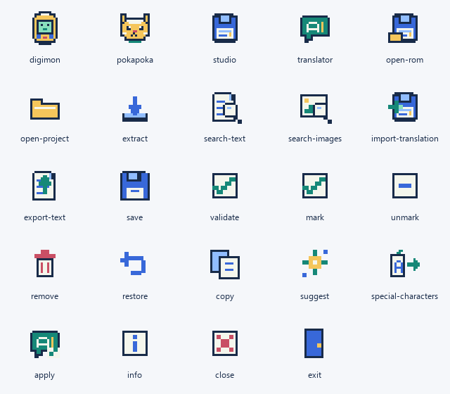
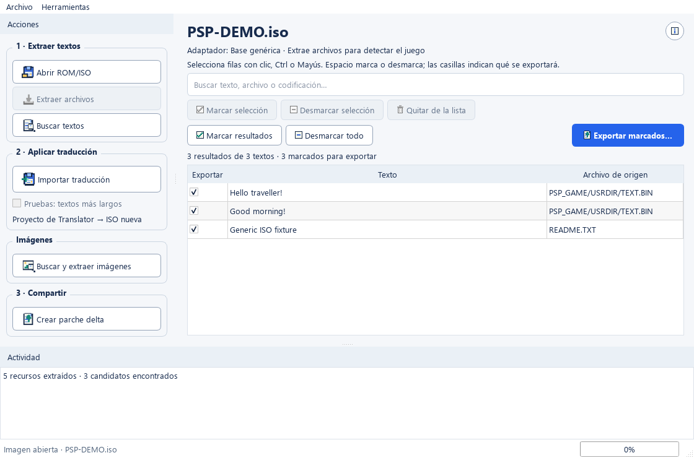
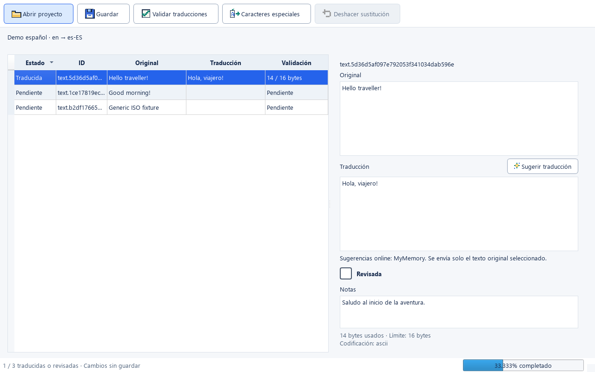

# ROMKit

Monorepo Python con un paquete compartido y dos aplicaciones de escritorio PySide6.

**ROMKit Studio y Translator 1.1.0**: [descargas de Windows](https://github.com/jcarlosab/romkit/releases/tag/v1.1.0).
Cada ZIP contiene el ejecutable y sus dependencias; extrae la carpeta completa.
También se ofrecen EXE autónomos de Translator, Base, Digimon y Poka Poka en esa release.
Estos EXE se abren directamente; el primer arranque puede tardar unos segundos.
Las releases del scraper y del organizador M3U tienen su propio historial.

Otras herramientas del repositorio: [ROMKit Scraper](tools/scraper/README.md)
para carátulas y [Retro M3U Organizer](tools/m3u-organizer/README.md) para organizar
discos y listas `.m3u`. Sus ejecutables siguen en la [release v0.32](https://github.com/jcarlosab/romkit/releases/tag/v0.32).
Retro M3U Organizer conserva su licencia [GPL-3.0](tools/m3u-organizer/LICENSE).

Los [catálogos actuales de los proyectos](catalogs/README.md) se publican por petición
del propietario y se abren directamente en Translator. No contienen ROMs ni extracciones.

El [trabajo editorial en español de Poka Poka](docs/pokapoka-spanish-draft.md)
conserva ñ y tildes. Su cobertura de borrador, procedencia y trabajo pendiente de
fuentes y reinserción se documentan por separado de la compatibilidad de los EXE.

Para publicar el proyecto, consulta [qué subir a Git y cómo distribuir los ejecutables](docs/git-layout.md).

**Studio** trabaja con la ROM y sus recursos. **Translator** permite traducir los
textos exportados. El flujo es común; los formatos internos requieren adaptadores
que dependen del juego, de su versión y, a veces, del parche aplicado.

## Guía rápida

El código propio de ROMKit Studio, Translator, el núcleo y sus scripts se publica
bajo [licencia MIT](LICENSE): uso gratuito, modificación y redistribución permitidos.
Las dependencias y herramientas con licencia propia conservan sus términos;
la MIT no cambia los derechos sobre juegos ni textos de `catalogs/`.

Los scripts de desarrollo y distribución están en [scripts/desktop](scripts/desktop/README.md).
No son otra aplicación; `tools/` contiene las utilidades independientes.

1. Instala las dependencias con `uv sync` y abre `uv run romkit-studio`.
2. Pulsa **Abrir ROM/ISO**, elige el juego y una carpeta de trabajo nueva para él.
3. Pulsa **Extraer archivos** y después **Buscar textos**. Filtra los resultados,
   selecciona las filas que quieras y pulsa **Marcar selección** o **Marcar resultados**.
4. Pulsa **Exportar marcados…** y elige una carpeta de traducción y los idiomas.
   Si partes de un parche inglés, el idioma de origen es inglés, aunque el nombre
   interno de los archivos siga diciendo `jp`.
5. Abre `uv run romkit-translator`, pulsa **Abrir proyecto** y elige la carpeta
   que contiene `project.toml`. Traduce, marca **Revisada** cuando corresponda y guarda.
6. Si el juego admite reinserción, vuelve a Studio con la misma ROM y carpeta de
   trabajo. Pulsa **Importar traducción…**, elige el proyecto y guarda una ISO nueva.
7. Comprueba la salida en un emulador o en el dispositivo. Conserva el original.

Para extraer gráficos usa **Buscar y extraer imágenes…** después de extraer los
archivos. Edita los PNG sin renombrarlos ni cambiar sus dimensiones y conserva
`imagenes.json`. Usa **Importar imágenes…**, selecciona esa carpeta y guarda una ISO
nueva. Las exportaciones anteriores a la versión 1.1 deben volver a extraerse.
Una imagen deduplicada se aplica a todas sus apariciones registradas.

Se admiten GIM de Poka Poka (sueltos y en BND compatibles) y GMIO v5 de Digimon.
Se conserva la paleta original: los PNG indexados deben usar sus mismos colores
RGBA, incluida transparencia. Los formatos directos de 16 bits requieren colores
representables sin pérdida. Se rechazan GIM con varios niveles/frames, ZIP,
contenedores desconocidos y cambios que afecten a vistas GMIO compartidas no editadas.
Los píxeles conservan su espacio; los recursos zlib pueden usar únicamente relleno
cero verificado antes del siguiente miembro BHD. No se amplían volúmenes ni la ISO.

### Compatibilidad actual

| Juego o caso | Extraer textos | Editar en Translator | Reinsertar textos | Extraer imágenes | Reinsertar imágenes |
| --- | --- | --- | --- | --- | --- |
| Poka Poka Ailu Mura G, LDMU 0x210 / FMG | Sí, CP932 indexado | Sí | Sí, con límites de bytes y espacio comprimido | GIM y formatos admitidos | GIM de una superficie/nivel, paleta y dimensiones originales; BND compatibles |
| Digimon World Re:Digitize PSP, VCRA 0x101 / BTX v1 | Sí, UTF-16LE, incluido el parche inglés probado | Sí | Sí, dentro de los bytes originales de cada cadena | GMIO v5; algunas paletas pendientes | GMIO v5 decodificable, paleta y dimensiones originales; vistas compartidas protegidas |
| Otros juegos con estructura PSP ISO9660 compatible | Candidatos genéricos; pueden requerir un adaptador | Sí, si se exportan textos válidos | Requiere un adaptador de escritura | Solo formatos y contenedores admitidos | PNG de igual dimensión que quepa en su espacio; otros formatos requieren adaptador |

La detección de texto no garantiza su reinserción. La existencia de IDs de otras
plataformas en el núcleo tampoco significa que sus ROMs puedan abrirse o reconstruirse.

### Qué carpetas debes conservar

```text
MiJuego/                       # carpeta de trabajo elegida en Studio
  .romkit/
    extracted/                 # archivos extraídos del juego
    metadata/                  # origen, candidatos y mapa de reinserción
MiTraduccion/                  # carpeta elegida al exportar marcados
  project.toml                 # idiomas, plataforma y hash de la imagen de origen
  text/main.jsonl             # originales, traducciones y revisión
```

`project.toml` lo crea Studio al exportar: no tienes que escribirlo a mano ni abrir
la ROM desde Translator. Para colaborar en la traducción basta compartir la carpeta
editorial. Para generar la ISO conserva también la ROM original y la carpeta de
trabajo con `.romkit/metadata`. Usa carpetas de trabajo diferentes para ROMs o parches
distintos; sus offsets y hashes pueden cambiar.

## Adaptar otra ROM con ayuda de IA

### Base, adaptadores y ejecutables exclusivos

La base y los juegos están separados en el código:

```text
src/romkit_core/adapters/
  registry.py            # detección, capacidades y perfiles, sin cargar todos los juegos
  pokapoka/
    reader.py            # FAT/BHD/BND y FMG
    writer.py            # reinserción FMG y compresión
  digimon/
    archive.py           # ARCV/MARV
    text.py              # BTX
    images.py            # GMIO
    writer.py            # reinserción fija
    repack.py            # redistribución experimental de cadenas
```

Studio muestra el adaptador seleccionado después de extraer los archivos.
Los módulos antiguos de `analysis/` y `project/arcv_rebuild.py` conservan imports
de compatibilidad; la implementación por juego vive en `adapters/`.

Perfiles: `all` incluye ambos juegos; `base` no incluye adaptadores;
`digimon` y `pokapoka` incluyen solo su juego. Puedes ejecutarlos desde el código:

```powershell
$env:ROMKIT_PROFILE = "digimon"
uv run romkit-studio
Remove-Item Env:ROMKIT_PROFILE
```

Para distribuir un ejecutable exclusivo, el perfil se fija en el launcher y se
excluyen los módulos de otros juegos durante la compilación:

```powershell
uv run --group build python scripts/desktop/build.py --profile base --app studio
uv run --group build python scripts/desktop/build.py --profile digimon --app studio
uv run --group build python scripts/desktop/build.py --profile pokapoka --app studio
```

Los resultados están en `dist/ROMKit Studio - Base/`, `dist/ROMKit Studio - Digimon/`
y `dist/ROMKit Studio - Pokapoka/`. El perfil predeterminado `all` mantiene
`dist/ROMKit Studio/`. Translator es común y no necesita adaptadores de juegos.
Digimon usa un icono pixel art de un dispositivo de mascota digital; Poka Poka,
una cara felina con orejas. El perfil aplica su icono al ejecutable, la ventana
y la barra de tareas. Base y el perfil completo conservan el cartucho de Studio.
Para añadir un juego, crea su paquete y registra un `Adapter` y un perfil en
`adapters/registry.py`; reutiliza el importador, proyectos y botones existentes.

### Procedimiento para la IA

Abre este repositorio en tu asistente de programación y pídele que lea
[AGENTS.md](AGENTS.md). Es el manual para extender ROMKit reutilizando su núcleo,
sus proyectos y sus botones. Si el asistente no carga ese archivo automáticamente,
indícaselo de forma explícita. El archivo orienta la investigación y la implementación;
no detecta formatos nuevos por sí solo ni garantiza que cualquier ROM sea adaptable.

Proporciona el juego, plataforma, región/versión, parche aplicado e idiomas, la ruta
local de la ROM y de la extracción, qué operación falla y un ejemplo de texto o
gráfico que debería aparecer. Una frase visible en el juego ayuda a distinguir
diálogo real de mensajes internos. No es necesario publicar la ROM en el repositorio.

Puedes copiar esta petición y sustituir los campos entre corchetes:

```text
Lee AGENTS.md y README.md de este repositorio y adapta ROMKit para [juego],
[plataforma y región/versión], con [parche o sin parche].
ROM local: [ruta]. Extracción: [ruta/.romkit/extracted].
Idioma de origen: [idioma]. Destino: [idioma].
Problema observado: [qué ocurre y qué debería ocurrir].
Ejemplo visible en el juego: [frase o descripción del gráfico].

Reutiliza los lectores, modelos y flujo de Studio/Translator existentes.
Investiga el contenedor y las tablas antes de cambiar el detector genérico.
Para textos, completa extracción, exportación, edición y reinserción mediante
el mismo botón Importar traducción, con un adaptador específico cuando haga falta.
Conserva el original y genera una imagen nueva. Añade pruebas sintéticas,
verifica la salida reabriéndola y actualiza la matriz de compatibilidad.
Indica lo probado con archivos reales, lo probado en emulador y lo pendiente.
```

Si solo buscas diagnóstico o extracción, cambia el alcance en esa petición. Para
añadir reinserción de imágenes, pídela expresamente: es una función distinta de
exportarlas como PNG y puede exigir conservar paletas, formato y límites originales.

La adaptación debe entregar un lector y, para el ciclo de traducción completo, un
escritor integrado, metadata suficiente para reconstruir, pruebas de ida y vuelta
y documentación de sus límites. Puede requerir investigar codificaciones propias,
fuentes, compresión, contenedores anidados o ejecutables. Los caracteres que puedas
escribir en Translator no necesariamente existen en la fuente del juego.

### Problemas habituales

- **No encuentra texto o muestra basura:** conserva la extracción y pide revisar
  índices, tablas, codificación y contenedores. Bajar los filtros puede aumentar
  falsos positivos; no demuestra que el texto esté ausente.
- **Hay texto japonés pero falta el inglés:** comprueba que abriste la ROM parcheada
  y usa un workspace nuevo si cambiaste de imagen. La traducción puede usar otras
  tablas o una codificación distinta.
- **No encuentra gráficos:** pueden ser texturas con paleta o estar dentro de un
  contenedor no admitido. Indica al asistente la carpeta extraída y ejemplos visibles.
- **Translator pide un proyecto:** primero exporta los marcados desde Studio;
  selecciona la carpeta con `project.toml`, no `.romkit/extracted`.
- **Importar traducción rechaza el proyecto:** consulta la compatibilidad anterior,
  usa la ROM y workspace originales y revisa los errores de bytes, controles e IDs.
  Un adaptador de lectura nuevo necesita también su adaptador de escritura.

## Scraper de carátulas

**ROMKit Scraper** busca y exporta carátulas para Cannoli, EmulationStation / RetroPie y ES-DE. Abre `dist/ROMKit Scraper.exe` o ejecuta `uv run python tools/scraper/romkit_scraper.py` desde la raíz del proyecto.

Consulta [la guía del scraper](tools/scraper/README.md) para las fuentes, configuración, selección de carátulas y compilación. Studio y Translator mantienen sus instrucciones a continuación.

## Organizador M3U

**Retro M3U Organizer** genera listas para juegos multidisco. Ejecuta `python tools/m3u-organizer/run.py` o abre `dist/Retro M3U Organizer.exe`. Consulta [su guía](tools/m3u-organizer/README.md).

## Estructura

```text
src/
  romkit_core/
    models/          # datos compartidos sin Qt
    workspace/       # archivos técnicos locales
    platforms/       # contratos y registro de backends
    transforms/      # cadena reversible y registro de handlers
    image/           # identidad de imagen por streaming
    analysis/        # inventario y candidatos de texto
    project/         # TOML, JSONL y generación de proyectos
    validation/      # tamaño, codificación y controles protegidos
  romkit_studio/
    models/          # estado de sesión
    windows/         # ventana principal
    widgets/         # inicio, recursos y actividad
    services/        # tareas en segundo plano y controlador
  romkit_translator/
    models/          # tabla Qt, sin widgets por fila
    windows/
    widgets/         # tabla y editor de traducción
    services/        # sesión editorial y guardado seguro
tests/
  unit/
  integration/
  fixtures/
```

## Instalación

Requiere [uv](https://docs.astral.sh/uv/getting-started/installation/).
Python 3.13 está fijado en `.python-version`; uv puede instalarlo automáticamente.

```powershell
uv sync
```

## Aplicaciones

Ejecuta cada comando en su propia terminal para abrir ambas ventanas simultáneamente:

```powershell
uv run romkit-studio
uv run romkit-translator
```

También admiten `uv run python -m romkit_studio` y `uv run python -m romkit_translator`.
Cada proceso crea su propia QApplication. Studio abre ISO9660 con estructura PSP,
extrae recursos y genera proyectos de traducción. Translator abre, edita, valida
y guarda el contenido editorial, sin acceder a la ROM ni a `.romkit/`.

Si `uv` no está en el PATH de PowerShell, utiliza su ruta de instalación:

```powershell
& "$env:USERPROFILE\.local\bin\uv.exe" run romkit-studio
```

### Desde PyCharm

Selecciona el intérprete existente `.venv/Scripts/python.exe` del proyecto.
En **Run → Edit Configurations → Python**, elige **Module name** y utiliza
`romkit_studio` o `romkit_translator`. El directorio de trabajo es la raíz del proyecto.

### Iconos y ejecutables de Windows

La versión se define en `src/romkit_core/__init__.py`; el paquete Python, las ventanas,
las propiedades de archivo de Windows y los paquetes de release utilizan ese valor.
Studio y Translator comparten versión porque comparten el mismo núcleo y formato
de proyecto. Las utilidades independientes de `tools/scraper` y `tools/m3u-organizer`
no se renumeran al publicar estos programas.

Studio y Translator usan iconos pixel art originales de 16 × 16 píxeles, escalados
sin suavizado: cartucho azul para Studio y bocadillo verde para Translator. Las
acciones comparten el mismo estilo. Los SVG editables y sus versiones PNG e ICO
están en `src/romkit_core/assets/`; `studio-favicon.ico` y `translator-favicon.ico`
son las variantes para navegador si se necesitan. Las aplicaciones son de escritorio.



Para regenerar los recursos y compilar ambas aplicaciones con sus iconos incrustados:

```powershell
uv run python scripts/desktop/generate_icons.py
uv run --group build python scripts/desktop/build.py
```

Se generan `dist/ROMKit Studio/ROMKit Studio.exe` y
`dist/ROMKit Translator/ROMKit Translator.exe`. Conserva cada carpeta completa,
incluido `_internal`, al copiar la aplicación a otro equipo.

El script compila con un entorno de búsqueda de DLL aislado y limpia el caché por
perfil para evitar bibliotecas ajenas. Después arranca cada `.exe` con el plugin
Windows de Qt, exige la creación de la ventana y una salida correcta, y guarda el
informe en `build/desktop-smoke/`. Un proceso que siga abierto por un cuadro de error
no cuenta como una prueba superada. Si tienes una compilación antigua con errores
al importar QtWidgets, sustituye su carpeta completa por la nueva, incluido `_internal`.

### Flujo en Studio

Las acciones están en el lateral **Acciones**, agrupadas en
**1 · Extraer textos** y **2 · Aplicar traducción**. Los botones muestran iconos,
borde y estados de disponibilidad. La ventana de información usa un fondo claro
incluso cuando Windows está configurado en modo oscuro.
Studio y Translator tienen tamaño fijo. Los paneles de Studio permanecen visibles
y no se pueden cerrar ni desprender; el menú **Ver** se ha eliminado.

1. **Abrir ROM/ISO**: selecciona la imagen y una carpeta de trabajo. Se calcula
   SHA-256 en segundo plano. Cuando la detección no es concluyente puedes elegir
   manualmente una plataforma registrada. Cancelar conserva la sesión anterior.
2. **Extraer archivos**: extrae la estructura compatible a `.romkit/extracted/`.
   Los recursos se conservan internamente para el análisis y la reinserción;
   no se muestra un árbol de archivos en la interfaz.
3. **Buscar textos**: busca secuencias candidatas de texto. La tabla muestra
   los textos y su archivo de origen. El botón **i** abre la información de la
   imagen y el texto actual, incluida su ruta de origen, codificación y confianza.
4. Usa el buscador para filtrar por texto, archivo o codificación. Selecciona
   filas con clic, Ctrl o Mayús; **Ctrl+C** copia sus textos. Pulsa **Marcar selección**
   para incluirlas en la exportación. **Desmarcar selección** quita las marcas
   de esas filas. **Espacio** alterna las marcas cuando la tabla tiene el foco.
   Las casillas también se pueden marcar individualmente.
   **Quitar de la lista** (o Supr) excluye las filas seleccionadas sin modificar
   archivos del juego. **Ctrl+Z** o **Restaurar última eliminación**, en el menú
   contextual, recupera lo quitado; se conservan hasta diez eliminaciones.
   Volver a analizar restablece la lista completa.
5. **Marcar resultados** incluye los resultados de la búsqueda y conserva las
   marcas anteriores, evitando duplicar fragmentos que ocupen los mismos bytes.
   Cambiar la búsqueda no elimina las marcas. **Desmarcar todo** las elimina todas.
6. **Exportar marcados…**: elige la carpeta editorial y los idiomas. Se generan
   `project.toml` y `text/main.jsonl`; los offsets y datos de reinserción permanecen
   en `.romkit/metadata/reinsert.json` de la carpeta de trabajo original.
7. Después de traducir y guardar en Translator, vuelve a Studio con la misma
   imagen y carpeta de trabajo. Pulsa **Importar traducción…**, selecciona la
   carpeta que contiene `project.toml` y elige un nombre nuevo para la ISO.
   Se insertan los textos con estado **Traducido** o **Revisado**; los pendientes
   conservan su original. No es necesario analizar de nuevo.

La reinserción admite FMG de POKAPOKA y BTX de Digimon PSP desde el mismo botón.
Para FMG comprueba el
hash de la ISO, la correspondencia de los IDs, el texto de origen, la codificación
CP932, las variables y los límites de bytes. Conserva los punteros de las tablas
y sus tamaños descomprimidos; las traducciones cortas se rellenan con ceros.
Los archivos se recomprimen dentro de su espacio original. Si un texto o una tabla
no cabe, la operación se detiene sin publicar una imagen incompleta.

La ISO nueva conserva el tamaño y las posiciones de todos los archivos. Solo se
sustituyen los datos BND y los tamaños comprimidos BHD necesarios; los demás
campos del contenedor se conservan. La copia se verifica antes de publicarse y
no sobrescribe archivos existentes. La carpeta `.romkit` original es necesaria
para relacionar el proyecto editorial con los datos de reinserción.

Los caracteres que CP932 no puede representar (por ejemplo algunos acentos
españoles) se rechazan; esta función no modifica la fuente del juego. Comprueba
el arranque y el texto final en PPSSPP. Los formatos de otros juegos aún no
disponen de reinserción salvo los adaptadores indicados en la tabla de compatibilidad.

Hashing, extracción y análisis utilizan el mismo runner de tareas Qt y devuelven
progreso y errores al hilo de interfaz. Al cerrar durante una operación, Studio
cancela el trabajo antes de destruir sus servicios. La extracción utiliza una
carpeta temporal y publica el árbol al completarse.

**Buscar y extraer imágenes…** busca PNG, JPEG, GIF, BMP y WebP en los archivos
extraídos, además de PNG y texturas PSP GIM incrustadas en otros archivos.
También lee **ARCVINFO/ARCVn VCRA 0x101** de Digimon World Re:Digitize PSP,
sus descriptores MARV y las texturas **GMIO v5** dentro de recursos KCAP.
Convierte color directo y paletas PSP a PNG conservando el alfa. No descifra
los archivos PGD de instalación ni implica soporte de las variantes de 3DS.
Las texturas que requieren paletas externas todavía se omiten con un aviso;
la compatibilidad con ARCV no significa que todas sus imágenes sean convertibles.
Las instrucciones para ampliar formatos y comprobar nuevos juegos están en
[AGENTS.md](AGENTS.md).

Abre contenedores anidados **ZIP, zlib/gzip y BND**, y los conjuntos indexados
**FAT/BHD/BND LDMU 0x210**, como POKAPOKA. Los lectores de contenedores están
separados de los decodificadores de imagen para poder ampliar los formatos.
Selecciona la carpeta de
destino; se crea una subcarpeta `ROMKit-imagenes-…` con las imágenes y un índice
`imagenes.json` que registra la cadena de contenedores, el offset y el hash.
Las imágenes repetidas se guardan una sola vez y sus procedencias se conservan
en el índice. Las entradas dañadas o no compatibles se registran como avisos,
sin detener la extracción del resto de las imágenes.

El lector GIM exporta PNG RGBA, recupera paletas y revierte el swizzle PSP.
Admite RGB565, RGBA5551, RGBA4444, RGBA8888 e índices de 4/8/16/32 bits; exporta
el primer frame y mipmap de cada bloque de imagen. No renderiza modelos 3D ni
reinserta gráficos. Los originales nunca se modifican.
Referencias de formato: [estructura GIM](https://github.com/jeffangelion/gimconv_v)
y [formatos de píxel PSP](https://dev.ppsspp.org/docs/psp-hardware/gpu/image-formats/).

El recorrido limita la profundidad a 8 niveles, cada entrada a 64 MiB, la expansión
acumulada a 2 GiB y la salida a 20.000 imágenes. El lector de índices LDMU conserva
su límite de 32 MiB por entrada. ZIP cifrados, variantes GIM no admitidas y otros
contenedores propios necesitan lectores adicionales; se informa de los casos
reconocidos que no pueden procesarse.

### Pruebas con textos mayores y parches delta

En Studio, **Pruebas: textos más largos** activa la redistribución experimental
para tablas BTX de Digimon. El modo normal mantiene el límite individual. En pruebas,
una frase puede crecer usando espacio liberado al acortar otras de **la misma tabla**.
Se conservan los IDs y se actualizan los punteros. Los tutoriales BTX independientes
también pueden crecer dentro del relleno cero de sus sectores ARCV: se desplazan sus
metadatos intactos y se actualizan su posición y el tamaño del miembro en ARCVINFO.
La ISO y los demás recursos conservan su tamaño y posición. Esta ampliación no se
aplica a tablas anidadas en KCAP ni a miembros con descriptores desconocidos. Si hay
datos intercalados, cadenas compartidas, relleno ocupado o el recurso completo no cabe,
se rechaza la operación. No se trunca ni se escribe
encima del recurso siguiente. No permite crecer sin límite y no se aplica a FMG.
Translator puede mostrar el aviso del límite original aunque este modo permita
redistribuir el bloque. Comprueba el resultado en PPSSPP: que los bytes quepan no
garantiza que las líneas o los glifos se vean bien. El proyecto y la ROM originales
no se alteran; los IDs editoriales siguen vinculados a los offsets de la base original.

**Crear parche delta…**, en **3 · Compartir**, genera un parche **BPS estándar**:

1. Abre como ROM de origen la imagen exacta usada para traducir.
2. Elige **Crear parche delta…** y selecciona la ISO traducida.
3. Elige un archivo `.bps` nuevo. ROMKit lo crea por bloques, comprueba los CRC
   del original, destino y parche y reconstruye el flujo de salida para compararlo
   byte a byte con la ISO traducida antes de publicar el parche.
4. Comparte el `.bps` e indica el SHA-256 de la ROM base, mostrado en Actividad.
   Para aplicarlo utiliza un programa compatible con BPS, como Floating IPS.
   ROMKit genera el parche; no incluye aún una acción para aplicar parches ajenos.

Si partes de la traducción inglesa de Digimon, el parche requiere **esa misma ISO
inglesa**, no la japonesa limpia. No es posible generar un parche desde la ROM
japonesa sin disponer de esa base para compararla.

La implementación BPS es propia y usa SourceRead/TargetRead, sin programas externos.
Es adecuada para los cambios que conservan posiciones de ROMKit; una reorganización
grande puede producir parches mayores. Se contrastó con la
[especificación BPS de byuu conservada en Flips](https://github.com/Sir-Walrus/Flips/blob/master/bps_spec.md).
También se investigó [Xdelta/VCDIFF](https://jmacd.github.io/xdelta/): permite generar
y aplicar deltas mediante una herramienta externa, pero no se distribuye ni se
invoca desde ROMKit en esta versión. No renombres un `.bps` a `.xdelta`: son formatos distintos.

### Flujo en Translator

Para Digimon World Re:Digitize PSP, **Buscar textos** abre ARCV y recupera las
tablas **BTX v1 UTF-16LE**, incluidos los textos ingleses del parche, menús y
cadenas cortas. El nombre interno `LanguageKeep_jp.res` puede contener inglés.
Se pueden exportar a un proyecto y abrir en Translator seleccionando inglés
como idioma de origen. **Importar traducción…** reinserta estas tablas en una ISO
nueva, también con proyectos BTX exportados antes de añadir la escritura. Conserva
la ROM y el workspace con la metadata original; no necesitas exportar de nuevo
solo para habilitar esta función. Cada traducción debe caber en los bytes UTF-16LE
de su cadena original y conservar los controles. En modo normal no se reubican cadenas: ARCVINFO,
MARV, índices y metadatos KCAP permanecen intactos, y solo se modifican los bytes
seleccionados en los volúmenes ARCV. Las cadenas cortas se rellenan con ceros.
Las fuentes del juego pueden no contener todos los caracteres Unicode; comprueba
el resultado en PPSSPP. Referencia de la estructura:
[BTXPayload de DecodeTools](https://github.com/SydMontague/DecodeTools/blob/master/src/main/java/net/digimonworld/decodetools/res/payload/BTXPayload.java).

1. **Abrir proyecto**: selecciona la carpeta que contiene `project.toml`.
2. Selecciona una fila para ver el original de solo lectura y editar traducción,
   y notas. Al escribir se marca como traducida. La casilla **Revisada** confirma
   la revisión y se desmarca al cambiar el texto; editar notas no la desmarca.
   Ordenar la tabla conserva el orden original de los archivos.
3. El editor muestra bytes usados y límite cuando la codificación es conocida,
   caracteres no representables y controles protegidos ausentes o duplicados.
4. **Guardar** o **Ctrl+S** reemplaza cada JSONL mediante un archivo temporal.
   Si el archivo cambió fuera de Translator, el guardado informa del conflicto.
5. Para confirmar un texto deliberadamente vacío, marca **Revisada**.
6. **Sugerir traducción** consulta MyMemory online con el original de la entrada
   seleccionada y los idiomas de `project.toml`. La propuesta aparece aparte;
   **Usar sugerencia** la copia al editor y mantiene la revisión sin marcar.
   No se publican las traducciones del proyecto en la memoria del servicio.
   Las propuestas siguen pasando las comprobaciones de bytes y codificación.

MyMemory limita cada consulta a 500 bytes UTF-8 y puede aplicar límites de uso.
El botón informa de textos largos, errores de red y límites alcanzados, sin
alterar la traducción existente. Las consultas son asíncronas y se cancelan al
cambiar de entrada. [Documentación del servicio](https://mymemory.translated.net/doc/spec.php).

Los proyectos editoriales pueden copiarse a otro equipo sin la imagen ni el workspace.
La barra inferior muestra el avance estimado: entradas **Traducidas o Revisadas**
divididas por todas las entradas del proyecto. Una revisada con traducción vacía
cuenta y una entrada traducida y revisada no se suma dos veces. Se actualiza al
editar, revisar, desmarcar la revisión o abrir otro proyecto; no mide calidad del texto.

## Base compartida (S1-02 a S1-05)

Los modelos usan dataclasses, validan valores y estados y ofrecen `to_dict()` /
`from_dict()` y `to_json()` / `from_json()`. `ProjectConfig` añade `to_toml()` /
`from_toml()` con esquema 1, plataforma, hash de origen e idiomas de origen y destino.
Las restricciones de texto admiten máximos de bytes, caracteres y líneas.
Los IDs de plataforma admiten futuros backends además de PSP, PS1 y Saturn.

`WorkspaceManager(project_root)` crea directorios bajo demanda dentro de `.romkit/`:
`source`, `extracted`, `analysis`, `metadata`, `build` y `cache`.
`register_source(image)` guarda ruta absoluta, SHA-256, tamaño y plataforma en
`metadata/source.json`; no copia la imagen. Solo `copy_source(relative)` copia
explícitamente el original y verifica su identidad antes de hacerlo.
Las rutas no pueden escapar del workspace y la metadata de origen es reservada.

`PlatformRegistry` registra implementaciones de `PlatformBackend` y permite
resolverlas por ID. `detect(path)` devuelve candidatos ordenados por confianza;
no propone plataformas sin evidencia. El backend PSP reconoce `PSP_GAME`,
`PARAM.SFO` y `SYSDIR/EBOOT.BIN`; la extensión `.iso` por sí sola no es evidencia.
El lector `Iso9660Reader` encapsula pycdlib, sin procesos ni herramientas externos.

`TransformPipeline.decode(data, steps)` devuelve bytes y una `TransformChain`
serializable. `encode(data, chain)` aplica las inversas en orden inverso.
La cadena puede guardarse con `WorkspaceManager.write_metadata()` y restaurarse
con `TransformChain.from_dict()`. Solo se incluye `IdentityTransform` en producción;
los handlers reversibles de las pruebas sirven exclusivamente para fixtures.
Los parámetros persistidos deben ser públicos; no incluir claves ni secretos.

## Interfaces y formatos (hasta S1-16)

`MainWindow(session=..., services=...)` permite inyectar `SessionModel` y
`StudioServices`. `StudioController` conecta las solicitudes de apertura,
extracción, análisis y generación. Los servicios del core aceptan callbacks Python
normales de progreso y no acceden a widgets. Los cambios en el modelo de sesión
actualizan las acciones, el árbol y la tabla de candidatos.

`TextScanner` usa una única memoria mapeada de solo lectura por recurso. Busca
ASCII, UTF-8, UTF-16LE/BE y Shift-JIS/CP932. La configuración inicial es conservadora:
mínimo 6 caracteres, 95% imprimibles (incluidos saltos de línea y tabulaciones),
confianza mínima 0.85 y máximo 1000 candidatos por recurso. También acepta frases
inglesas de varias palabras sin terminador cero, al final del archivo o separadas
por bytes de control. `ScannerConfig` permite ajustar estos umbrales y exigir
un terminador con `require_terminator=True`.

La búsqueda de cadenas sueltas exige escritura latina o japonesa coherente y
rechaza mezclas de alfabetos, identificadores y secuencias repetitivas que suelen
aparecer al interpretar datos binarios. No busca frases directamente en imágenes,
audio, vídeo, ejecutables ni contenedores reconocidos. Estos filtros son
conservadores y pueden omitir cadenas ambiguas; no modifican los textos leídos
desde tablas indexadas.

Cuando Studio reconoce las tablas de un juego, prioriza esas tablas y solo añade
archivos de texto explícitos (`txt/csv/xml/json/ini`). Evita así duplicados y falsas
traducciones procedentes de texturas, archivos instalables o ejecutables. El modo
aplicado se guarda en `.romkit/metadata/text_detection.json`.

Para **MonHun Nikki: Poka Poka Ailu Mura G (PSP)**, Analizar reconoce el conjunto
`POKAPOKA.FAT` / `POKAPOKA.BHD` / `POKAPOKA.BND` de versión `0x210`. Recorre los
directorios FAT, lee las posiciones BHD en sectores de 1024 bytes y descomprime
las tablas FMG con zlib. Los textos se leen por sus índices y se decodifican como
CP932, incluidos nombres cortos que el buscador genérico descartaría.

Los candidatos muestran una ruta virtual bajo `POKAPOKA.BND.contents`, con el
número de entrada y el nombre FMG. El lector trabaja en memoria y no modifica
los archivos extraídos. `.romkit/metadata/archive_resources.json` conserva el
origen de cada tabla, también incluido en la metadata de los proyectos creados.
La opción **Importar traducción…** permite reconstruir estas tablas y generar
una ISO separada con las traducciones guardadas en el proyecto.
Las coincidencias siguen siendo candidatos hasta su confirmación por el usuario.

Los IDs de traducción se derivan de ruta lógica, offset y codificación; editar
`target` nunca cambia el ID. Generar de nuevo la misma selección conserva las
traducciones existentes. La carga de JSONL valida campos e IDs duplicados y
presenta errores con archivo y número de línea.





## Pruebas

```powershell
uv run pytest
```

Las pruebas de integración arrancan cada entry point instalado en un proceso independiente,
verifican que muestra su ventana y cierran el bucle Qt. Usan `offscreen`, sin pantalla.
También verifican el workspace, la protección de la imagen original, la lectura
ISO y extracción PSP con fixtures sintéticos, todas las codificaciones del scanner,
el recorrido Studio → proyecto → Translator, cancelaciones, guardados fallidos y
5000 unidades con orden editorial estable. Los fixtures no contienen datos de juegos.
Una prueba de enlaces simbólicos se omite si Windows no permite crearlos.

El archivo `.gitignore` excluye entornos locales, cachés, builds, `.romkit/` e imágenes ROM/ISO.
